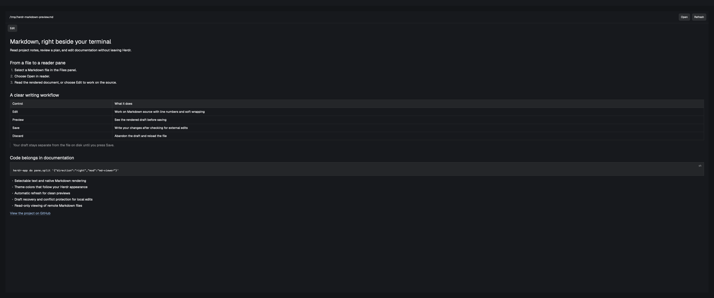

# Reader for Herdr

A native Markdown and image reader for [Herdr](https://herdr.dev), with Markdown editing and a Files pane for browsing, creating, importing, renaming and deleting files. Renders `.md` and `.markdown` files directly with Herdr's built-in `TextView`, with selectable text, scrolling, theme colors, automatic refresh every three seconds, and local file editing with explicit saves. Images and Mermaid diagrams are rendered by a local Node.js helper.



Available to the Herdr community through the `herdr-mod` topic. [RECIPE.md](RECIPE.md) describes how to build and install it from an empty folder.

## Install

With Herdr, Node.js 22+ and npm installed:

```sh
git clone https://github.com/giacolees/herdr-reader.git
cd herdr-reader
```

```sh
./scripts/install.sh
```

To also connect the Files pane in the active layout:

```sh
./scripts/install.sh --files
```

This clones Herdr's shipped Files mod into `md-files`, installs the companion, and changes the active personal layout's Files reference. A shipped layout is cloned first. The original layout file is backed up under `~/.config/herdr-app/backups/md-viewer/`. Other layouts retain their own Files mod. Requires Python 3 for this optional integration.

The basic install copies this mod into `${HERDR_APP_HOME:-~/.config/herdr-app}/mods/reader` and runs Herdr's checker. Run again after updating the repository.

Existing `md-viewer` panes remain supported after upgrading; new panes use `reader`.

## Open a file beside your terminal

```sh
herdr-app do pane.split '{"direction":"right","mod":"reader","props":{"file":"/absolute/path/README.md"}}'
```

Or open an empty viewer and type a path or drop a Markdown or image file into it:

```sh
herdr-app do pane.split '{"direction":"right","mod":"reader"}'
```

Press Enter or Open to load a path. Relative paths resolve against the terminal folder focused when the viewer starts. Local `~/` paths are supported. Refresh reloads immediately; changes are otherwise picked up within three seconds. Empty documents render as empty documents; unreadable files display an error and are retried automatically. Each pane holds its own document. Files are written only when you press Save.

For a remote file, pass an absolute path and `"on":"machine-name"` in props. Drag-and-drop paths refer to local files, so use that with local viewers.

## Open from Files

In the connected Files pane, click a Markdown or supported image file to open Reader directly inside Files. Click **← Files** to return to the list with expanded folders preserved. No new pane is created. Markdown drafts are kept when returning to the list and recovered when you reopen the file. Other files retain their normal source preview.

Use the **new file** or **new folder** SVG icon in the Files header to create an item. Enter a name or a path relative to the displayed root, such as `docs/notes.md`, then press Enter or Create. Parent folders must exist. Existing items are never overwritten, and errors keep the entered name for correction. New items appear in the list immediately. Creation also works on connected Unix machines.

Drop one or more files from Finder or your file manager anywhere in Files to copy them into the selected folder, including while a preview is open. Expanding a folder selects it as the destination; the drop strip shows its full path. Collapsing it returns the destination to its parent. **Use root** resets the destination to the browser root. Dropping directly onto a folder row copies into that folder, even when it is collapsed, without changing the selected destination. Originals remain in place, existing names are skipped with an error, and successful copies appear immediately. Dropping folders and importing into remote folders are not supported.

To move a file already in Files, drag its row onto a folder and release. The folder is highlighted and the bottom strip shows the target path. Drop on the **Root folder** row below the header, or on the bottom strip, to move it to the browser root. Releasing elsewhere or leaving the pane cancels the move. Existing destination names are never overwritten.

Right-click a local `.html` or `.htm` file and choose **Open in browser** to launch it in your configured default web browser. Remote HTML files do not show this action.

On macOS, right-click a local file or folder and choose **Reveal in Finder** to open its containing folder with the item selected.

Right-click any file or folder and choose **Copy path** to copy its absolute path. For files on an SSH machine, **Download…** lets you choose a local destination folder. Downloads preserve the remote original, refuse existing destination names, and show progress or errors in Files. Transfers use chunks, so the image preview's 5 MiB limit does not apply. Changing the Files location cancels an unfinished download and removes its partial file. Downloading folders is not supported.

Right-click a file or folder and choose **Rename…**, enter its new name, then press Enter or Rename. Existing names are refused. Folder renames preserve expanded descendants and the selected copy destination.

Right-click a file or folder and choose **Delete…**. Confirm **Delete permanently** to remove it; deleting a folder also removes its contents. Cancel leaves it untouched. Failed deletions show an error, and the list refreshes after a successful deletion.

Reader also remains available as a standalone pane using the command above.

## Edit and save

Click **Edit** to edit Markdown source. **Preview** renders the current draft without saving. When changes exist, **Save** writes them to the local file and **Discard** abandons the draft and reloads from disk. Save checks that the file still matches the version originally read; conflicting external changes leave both the disk file and your draft intact. Copy the draft elsewhere before discarding if you need to reconcile a conflict.

Automatic refresh pauses while editing or when unsaved changes exist. Opening another path or refreshing cannot discard a dirty draft. Drafts are stored per file within the pane's local storage, so they can recover after a hot reload or app restart while that pane remains. Removing the pane removes its copy of state; save before closing it. Remote files are read only because Herdr's `writeTextFile` API writes locally only.

## Validate

```sh
herdr-app check mods/reader
herdr-app check ~/.config/herdr-app/mods/md-files
node --test tests/viewer.test.mjs tests/files.test.mjs tests/renderer.test.mjs
```

Herdr must provide the `gpui-kit`, `gpui-base`, and `herdr` runtime modules. This is a native mod, not a browser or Node application. Text and links use Herdr’s native Markdown renderer.

## Images and Mermaid

Open standalone PNG, JPEG, GIF, WebP, SVG, AVIF or TIFF files using the same path field, drag-and-drop, or a click in Files. Images scale to the pane width, preserve their aspect ratio and display their filename. Image files are read only; GIF previews show a still frame. Press Refresh to pick up changes to the image. SSH image previews use the existing Herdr machine connection: open an image from remote Files, or pass its absolute remote path and `"on":"machine-name"` in Reader props.

The installer installs a local rendering helper and Chromium through Mermaid CLI. PNG, JPEG, SVG and other Sharp-supported images are converted to native previews. Relative paths resolve against the Markdown file’s folder; HTTP(S), file URLs, data URLs and reference-style Markdown images are supported. Images appear as separate blocks, including images embedded in a paragraph or list; HTML `` tags are not handled by this helper.

Fenced `mermaid` blocks render locally as images at 2× resolution with transparent backgrounds and the current light/dark appearance. Failed images and diagrams show an error; invalid diagrams retain their source. Ordinary code blocks remain code. Rendered diagrams are images, so their labels are not selectable. Remote Markdown supports images and diagrams too: relative image paths resolve beside the remote document, and absolute paths and file URLs refer to that machine. HTTP(S) images are fetched locally. SSH transfers support Unix hosts with `sh`, `wc`, `head` and `base64`, with a 5 MiB limit per image; Node.js and renderer dependencies are needed only locally. Assets are cached under Herdr’s `data/md-viewer/media`; generated cache files unused for 24 hours are removed automatically after rendering a document. Reusing a diagram renews its retention period. Cleanup runs when a document renders, rather than while the reader is idle. You can also remove that folder to clear the cache. Refreshing a clean document picks up Markdown changes; press Refresh to reload image-only changes.

Open `examples/media-test.md` to check local images, remote images, flowcharts and sequence diagrams. Renderer tests require `npm ci --prefix renderer`, followed by `node --test tests/renderer.test.mjs`.
